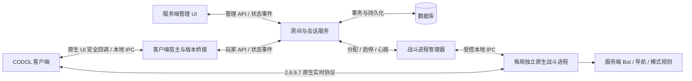

# CODOL 独立服务端、房间通信与 Bot 对战实施方案

日期：2026-10-15  
适用版本：CODOL 2.6.9.7  
文档性质：实施设计与验收计划；文中的新接口、目录、状态机和性能指标均为拟议设计，不代表已经实现。

2026-10-15 修订：M0 已完成，实际结果见《M0验收与接入报告》。用户进一步明确最终代码必须架构清晰、边界明确；现增加 M1 前的 R0 结构整理，以及贯穿 M1～M6 的结构验收。R0 与 M1 已完成；M2 原生建房、阵营/地图修改核心链路已打通，完整集成与结构验收待收尾。最新状态见《M2验收与接入报告》。具体长期要求见 [ADR 0002](../../docs/adr/0002-代码架构与重构交付要求.md)；第 2 节保留规划时基线，不替代最新验收报告。

## 1. 目标与实施结论

本阶段要交付的完整操作链如下：

1. 用户独立启动服务端，打开管理 UI；此时可以不启动游戏客户端。
2. 用户启动客户端，在游戏原生大厅中创建房间。
3. 服务端收到请求，创建房间，并把成员和配置同步到客户端与管理 UI。
4. 管理员通过服务端 UI 添加 Bot、选择支持的地图与模式，并开始游戏。
5. 服务端准备独立战斗进程，客户端收到入场信息，进入地图。
6. 玩家能够与 Bot 移动、交火、死亡、重生，直到本局结束。
7. 服务端生成本局结果，客户端返回房间，可以再次开局。

建议采用 **独立管理 UI + 模块化房间服务 + 独立原生战斗进程**。房间服务管理身份、规则、成员和对局生命周期；战斗进程负责移动、碰撞、伤害、Bot 与实时同步。客户端负责输入、画面和预测，不能决定最终伤害、分数或房间状态。

第一版交付范围：同一台电脑、一个真人、一个活动房间、一张验证通过的地图、一种模式、可配置的少量 Bot、完整开局与回房间流程。架构从第一版支持独立身份、网络连接和每局隔离；双客户端局域网验证作为后续强制架构验收，不能长期停留在只能运行一个本地玩家的设计。

“商业项目生产代码标准”在本项目中落实为：明确模块边界、唯一状态权威、可恢复生命周期、协议契约、权限校验、自动化回归、可观测性、可复现构建和可回滚发布。初期不引入微服务集群、消息中间件或 Kubernetes；这些不是达到代码质量要求的前提。

## 2. 当前基线与证据可信度

### 2.1 本次已核对的事实

| 项目 | 核对结果 | 对方案的影响 |
| --- | --- | --- |
| 新项目入口 | `cli.py` → `app/lifecycle.py` → `app/context.py` → `v2697/session.py` | 继续保留启动器，新增通信适配，不把服务端业务塞进启动入口 |
| 大厅能力 | 当前实现本地档案、仓库、原生大厅与资源供给 | 本地宿主不是账号/房间协议服务器 |
| 运行互斥 | `app/session_lock.py` 对整个客户端项目使用单会话锁 | 同机双客户端需要实例化改造，不能直接删除锁 |
| 导入与全局状态 | `CODOL2697_GAME_DIR` 在模块导入前设置；设置存储有模块级引用 | 不在一个 Python 进程中复用多份客户端会话；每客户端宿主独立进程 |
| 网络保护 | `v2697/session.py` 校验 guard 范围为 UDP `127.0.0.1:28969`、单子进程及关闭时清理 | 第一阶段保留本地限制；多端口或局域网必须单独修改并验证保护策略 |
| 当前可读证据 | `.lobby/29c2747d/summary.json` 记录曾到达大厅、库存 6569、角色 1902、`errors=[]` | 能支持本地大厅基线，不能证明房间和对战 |
| 清理记录 | 同会话 `result.json` 记录 `child_terminated=true`、guard `engine_close_status=0` | 是现存历史运行证据；本次没有重新启动游戏 |
| 旧项目参考 | 旧源码存在 `native/`、房间桥接、快照编码、Bot 难度测试 | 可以迁移经过核对的能力，不必假设所有战斗逻辑都要重新逆向 |

当前会话汇总中的最后采样 `movie=0`、`ui_activated=0`，但 `lobby_ready=true`。应按“曾到达大厅”的记录理解，不能把退出前后最后一次采样当作大厅持续正常运行的证明。

### 2.2 交接资料与实际目录的差异

- 交接资料列出的 `e53d0c92`、`81c26ced`、`bbefe772` 历史目录本次未在 `.lobby` 中找到；相关结论只能注明来自历史文档，M0 重新建立可访问的验收证据。
- `Client/docs/从零理解本地大厅.md` 当前不存在；本方案不把它作为已阅读依据。
- `architecture.md` 把原生退出异常归因于在线结束流程，但 AGENTS.md 明确说明根因未证明。以后沿用“原因待查”的表述。
- Git 当前有已跟踪源码和多项未跟踪资料；先整理变更基线，不把整个工作区视为干净状态，不擅自覆盖现有工作。
- 旧项目 README 描述了本地原生服务器和 Bot 相关能力；本次只核对文档、部分源码与测试结构，没有重跑其验收。旧项目成功不等于新项目已成功。

## 3. 三类进程与数据流

### 3.1 部署关系



这是目标连接关系。协议适配和安全入场尚需实现、验证；图中箭头不表示现有客户端已经支持这些功能。

### 3.2 各部分职责

| 组件 | 负责 | 不承担 |
| --- | --- | --- |
| 管理 UI | 查看连接/房间/日志；配置 Bot；开始/停止对局；展示失败原因 | 直接读写客户端内存、直接写数据库、执行任意原生控制台命令 |
| 房间与会话服务 | 玩家会话、成员、权限、房间状态、开局操作、结果归档 | 每帧移动、弹道、碰撞和 Bot 思考 |
| 战斗进程管理器 | 资源预检、启动、就绪探测、心跳、退出、孤儿进程核对 | 根据“进程存在”宣布对战成功 |
| 原生战斗进程 | 服务器权威模拟、Bot、模式规则、原生网络快照 | 承载管理网页和账号业务 |
| 客户端宿主/桥接 | 原生 UI 请求转换、状态投影、入场与返回大厅、连接管理 | 私自创建权威房间、擅自生成结算结果 |
| 数据库 | 身份、房间配置、操作记录、对局摘要、审计记录 | 每帧坐标和弹道实时存储 |

服务端启动、关闭与客户端独立。关闭管理网页不结束服务；客户端退出不关闭服务。战斗子进程由服务器管理器拥有，不继续由客户端启动器代管。

### 3.3 “可独立启动的 UI 服务端”的具体含义

默认交付浏览器管理 UI：独立的 `Server/Start.cmd` 启动服务，再打开本地管理页。也提供无 UI 的服务启动入口，便于后台运行与自动化测试。这里的启动脚本是计划交付物，目前不存在。

页面包括：

1. 总览：服务存活/就绪状态、版本、客户端连接数、活动房间、战斗进程状态。
2. 房间列表与详情：房主、真人/Bot、阵营、准备状态、地图、模式、版本号。
3. Bot 配置：数量、阵营、难度；明确区分“配置席位”与“已经在地图中生成”。
4. 对局控制：预检、开始、取消启动、结束；显示操作编号与当前阶段。
5. 诊断：按房间/对局查看关联日志，导出脱敏证据。

按钮启用状态由服务端返回的可用操作决定；即使前端按钮隐藏，后端仍独立校验权限与状态。启动耗时通过阶段反馈展示，不能用固定等待时间伪造完成。

若以后需要桌面窗口，可为同一 UI 增加桌面外壳，不重写服务端业务。

## 4. 技术选择与代码组织

### 4.1 建议的技术基线

| 部分 | 建议 | 原因与限制 |
| --- | --- | --- |
| 房间/管理服务 | Python、FastAPI、类型化契约 | 与现有宿主语言一致；便于清晰分层；不承担游戏实时循环 |
| 管理 UI | TypeScript + React，构建后由服务端提供静态文件 | UI 与服务接口分离；发行包无需玩家安装前端构建工具 |
| 持久化 | M1 起使用 SQLite 单实例；M6 前提供 PostgreSQL 实现与迁移验证 | 先保持本地启动简单，随后验证多连接并发与事务差异 |
| 战斗运行时 | 整理迁移旧项目原生 C/C++/ASM 能力，增加明确适配接口 | 旧项目已有协议和引擎基础；逐项验证，不直接运行旧启动器 |
| 客户端 | 保留现有 Python 宿主；新增最小 x86 原生房间桥接 | 版本地址与调用约定只留在版本适配层 |
| 可观测性 | JSON 日志、指标、关联 ID；逐步接入 OpenTelemetry | 首先保证一局出错后能沿请求找到所有进程的证据 |

这是基于本项目的设计建议，不要求本次安装依赖。具体版本在 M0/M1 依据本机工具链确定并锁定；客户端桥接继续使用 `Client/python/python.exe`，服务端建立自己的受控运行环境，不能通过升级客户端内置 Python 解决服务端依赖。

初期房间服务只启动一个应用工作进程，不能依靠进程内字典并盲目增加 worker：不同 worker 的内存不是共享房间存储。[FastAPI 部署说明](https://fastapi.tiangolo.com/deployment/concepts/)

多人阶段的成员变更依靠数据库事务、唯一约束与版本条件更新；需要时使用行锁，但不能在等待战斗进程启动期间长时间持锁。[PostgreSQL 锁说明](https://www.postgresql.org/docs/17/explicit-locking.html)

### 4.2 计划目录

```text
D:/Games/CODOL/
  Client/                         现有客户端，继续保留
    src/codol/online/             玩家会话、连接、契约转换
    src/codol/v2697/              原生 UI、协议与版本桥接
  Server/
    src/codol_server/
      domain/                    Room、Match、Participant 与规则
      application/               建房、配 Bot、开局、结束等用例
      transport/                 管理 API、玩家 API、事件订阅
      infrastructure/            数据库、时钟、身份、日志
      runtime/                   战斗进程监督与能力检查
    ui/                          管理 UI 源码
    tests/                       领域、契约、集成与故障测试
    migrations/                  数据库迁移
    config/                      配置模板，不包含密钥
  GameServer/
    native/                      迁移整理后的原生服务端
    adapter2697/                 版本协议与资源适配
    scripts/                     已验证模式及 Bot 脚本
    manifests/                   资源、构建与来源清单
    tests/                       原生协议与战斗回归
  Contracts/                     请求、事件、运行时 IPC 契约
  docs/adr/                      重要架构决策及取舍
  .server-runs/                  每局可写目录与证据，运行数据不入 Git
```

领域层不导入 FastAPI、数据库驱动、Win32 或客户端地址常量。应用层依赖仓库、时钟、运行时、事件发布等接口；基础设施实现接口。所有新增代码文件与函数添加详细中文注释，解释约束、失败处理和版本依据，不只翻译函数名。

迁移底层代码必须登记来源、原文件哈希、修改点、许可证、回归证据。保留“底层迁移、上层重写”的真实边界。任何新项目运行路径不得指向旧启动器目录；不重新执行历史批量导入脚本覆盖已维护模块。

最终结构要求同时覆盖 Python 控制服务、客户端宿主、CODOL 版本适配及自维护原生引擎。允许保留必要第三方库和已验证算法，但不能让业务通过任意全局变量、内存地址或隐式路径跨越模块边界。正式构建、实验工具、历史迁移、资源和运行产物必须可区分。目录改名和注释补充不代替职责拆分、状态所有权和接口约束。

## 5. 客户端与服务端通信设计

### 5.1 分开处理房间通信与战斗通信

**房间通信**频率低，传递建房、准备、Bot 配置和开局等业务。使用 HTTPS/JSON 命令接口和 WebSocket 事件连接；开发机回环模式可用 HTTP。第一版由客户端宿主连接房间服务，原生客户端通过受限本地 IPC 与宿主交换 UI 意图和状态。

**战斗通信**频率高，传递输入与服务器快照。保持客户端兼容的原生实时协议，由原生战斗进程处理。不能把自定义 WebSocket 坐标广播当作 CODOL 对战协议，也不能把每帧数据绕进管理 API。

本地桥接只接受有限类型命令，并验证会话身份、长度和参数；网络处理不阻塞 Windows 调试事件循环。网络线程将事件放入有界队列，版本适配层在已验证的原生安全回调点消费；队列满或会话切换时明确拒绝/丢弃过期事件，不跨线程任意修改原生 UI 对象。

### 5.2 身份与权限

- `player_id` 由服务端生成且不可因改名改变；用户名仅用于显示。
- 当前固定本地 UID `4294967297` 不能直接作为所有网络账号 ID。建立服务端 ID 与原生 ID 的兼容映射，先验证原生字段宽度、编码与唯一性。
- MVP 使用服务端签发的本地测试身份及短期会话令牌；这是明确标识的开发登录，不冒充官方账号协议。
- 管理员可配置 Bot 和开局；玩家只能操作自己有权限的房间。未来房主开局权限通过策略开放，不把管理员令牌交给客户端宿主。
- 多人版本必须落实独立身份、会话撤销、重复登录策略、TLS 与连接速率限制。
- 本地玩家档案与服务器账号数据分离。客户端设置仍本地保存；服务端验证本局允许的装备。不得把客户端上传的等级、货币或本地全量仓库直接变为线上权威数据。

### 5.3 拟议契约

所有可重试写操作携带 `request_id`；涉及房间修改的操作另带 `expected_room_revision`。身份来自经过验证的连接，不信任请求体中的用户名或玩家 ID。

| 命令 | 发起者 | 校验与结果 |
| --- | --- | --- |
| `CreateRoom` | 客户端 | 校验会话、支持的地图/模式、数量限制；返回房间快照 |
| `JoinRoom` / `LeaveRoom` | 客户端 | 校验席位、状态、重复成员；原子更新 |
| `SetReady` | 客户端 | 修改本人准备状态 |
| `ConfigureBots` | 管理 UI | 校验管理员权限、席位、导航与难度支持 |
| `StartMatch` | 管理 UI | 冻结配置、持久化启动意图；返回异步操作编号 |
| `CancelStart` / `StopMatch` | 管理 UI | 状态与权限检查；记录原因和清理结果 |
| `GetRoomSnapshot` | 双方 | 返回完整状态与单调递增的 `revision` |

推送事件包括 `RoomUpdated`、`MatchPreparing`、`MatchReady`、`MatchStarted`、`MatchFinished`、`MatchFailed`。事件带 `event_id`、`room_id`、`match_id`（适用时）、`revision`、协议版本和服务端时间。

错误码至少覆盖：`UNAUTHENTICATED`、`FORBIDDEN`、`ROOM_FULL`、`REVISION_CONFLICT`、`INVALID_STATE`、`UNSUPPORTED_CONTENT`、`RUNTIME_NOT_READY`、`START_TIMEOUT`。用户界面显示中文原因；日志保留错误码与操作编号。

### 5.4 重试、并发与重连

1. 相同身份、操作类型与 `request_id` 的重试返回原结果；同 ID 不同参数直接拒绝。
2. 房间修改在事务内检查版本和状态。两次开局并发只能创建一个活动 `match_id`。
3. 房间变更与待发布事件在同一事务记录；通过数据库待发送表发布，避免写库成功却永久漏通知。
4. 事件允许重复，消费者按 ID/版本去重；不承诺网络“恰好一次”。
5. 重连优先补齐有限历史事件；游标过期则请求完整快照。客户端不把本地缓存回写成权威状态。
6. 房间名单变化、地图切换或 Bot 配置修改使旧的准备确认失效；不得沿用不匹配配置的准备状态。
7. 协议主版本不兼容明确拒绝；小版本通过能力协商扩展。房间事件版本与战斗线协议版本分别管理。

## 6. 房间与对局状态机

房间是可以多次使用的容器，对局是一次独立战斗。一次房间可以先后关联多个对局，不能重复使用同一个对局 ID。

```text
Room:  OPEN → STARTING → IN_MATCH → OPEN
         └────────────────────────→ CLOSED
Match: ALLOCATING → LOADING → READY → RUNNING → FINISHING → FINISHED
         任一未终结状态 → FAILED 或 CANCELLED（按允许转换与原因记录）
```

| 阶段 | 必须具备的事实 | 失败后的处理 |
| --- | --- | --- |
| OPEN | 成员与配置可修改 | 房主离开时按明确策略转移或关闭 |
| ALLOCATING | 启动意图已入库，配置快照固定，容量已占用 | 释放占用，房间恢复 OPEN |
| LOADING | 专属进程启动，实际绑定端口，正在加载资源 | 超时/崩溃则清理并标记失败 |
| READY | 运行时上报地图、模式、协议、资源版本与本局 ID 匹配 | 不匹配不得发送入场信息 |
| RUNNING | 玩家真实入场，模拟持续推进，Bot 实体已确认 | 运行时故障终止本局，不伪造正常胜负 |
| FINISHING | 引擎产生终局事件，等待结果可靠保存 | 结果待重试，不重复发奖 |
| FINISHED | 唯一结果已落库，运行时已退出或进入明确回收阶段 | 返回房间；清理失败仍独立标红 |

启动流程采用可恢复的分步操作，不用跨数据库与操作系统的“全局事务”：先保存启动意图，再分配/启动，核对成功后推进状态。每一步都能按 `match_id + attempt_id` 重试和核对。

取消操作要处理“取消与就绪同时到达”的竞态。过期启动尝试即使随后报告 READY，也不得让客户端进入已经取消的对局。

服务器重启后先核对未终结对局和实际子进程。无法证明归属与状态的对局标记中断并清理；MVP 不承诺恢复正在进行的战斗。终局结果按 `match_id` 唯一写入，未来奖励采用独立幂等账本；本阶段只保存对局结果，不实现经济系统。

## 7. 原生战斗运行时与 Bot 路线

### 7.1 优先迁移已有原生能力

旧源码包含 `server2697/native/`、`client_room2697.cpp`、`room_host2697.py`、`run_room_match2697.py`、快照/输入适配及 Bot 测试。旧技术文档说明其服务器结合了兼容引擎、版本协议适配、地图资源与 waypoint 导航。

因此首选路线是：在新 `GameServer/` 中建立可追溯的原生构建和稳定控制接口，复用核对后的协议、资源与 Bot 算法。不能整体复制旧启动链，再在外面套一个管理窗口就称为架构重写。

M0 需要证明的最低能力：

- 独立启动原生进程，不需要已有玩家客户端维持其生命周期。
- 能加载一张候选地图与模式，确认模拟循环实际推进。
- 核对当前客户端所需 gamestate、快照、输入、资源编号和连接阶段。
- 验证资源、脚本、模型、碰撞和导航都能从新项目清单定位。
- 明确旧代码中绑定本地端口、单玩家、固定 UID、RCON、绝对路径和客户端退出即关服的假设。

旧测试出现 `mp_killhouse_sh` 与 `dm`，可作为首批候选，不直接宣布它们已在新项目中兼容。如果无法独立启动，要将“恢复独立运行时”列为阻塞工作，重新估算；不能用客户端内部本地开图替代独立服务器的验收。

### 7.2 战斗适配器接口

运行时管理层至少提供：`Prepare`、`Start`、`GetStatus`、`ConfigureBots`、`Stop`、`CollectResult` 和 `CollectDiagnostics`。各接口有结构化输入、超时、结果和错误码。

初期每局一个进程、一个可写目录、固定版本资源清单；静态资源只读共享。进程管理器记录 PID、创建时间、实例随机标识及句柄，避免 PID 复用后误杀无关进程。端口是否可用以真正 bind 成功为准，预检查不能替代真实绑定。

首版本仍限制一个本地活动战斗端口 `28969`；第二房间启动应明确报告容量不足。扩展到多对局时再引入端口分配池，并同步修改客户端 guard 白名单。

旧 RCON 如用于迁移验证，仅限管理器本机连接、随机密钥、固定命令白名单，不向管理网页暴露原始命令输入，也不把口令记录进日志。长期用结构化 IPC 替代文本控制与日志猜测；日志保留诊断价值，不作为唯一权威状态。

### 7.3 Bot 的职责与等级

“添加 Bot”首先改变房间配置；只有原生进程确认实体生成并参与模拟，UI 才标记为在局。Bot 不通过 HTTP 模拟真人登录，也不需要为每个 Bot 启动客户端。

Bot 使用与真人相同的权威移动、武器、伤害和计分规则。决策模块生成输入意图，交由游戏模拟执行。优先整理旧导航与行为能力，分级验收：

| 层级 | 能力 | 可观察的证据 |
| --- | --- | --- |
| B0 | 创建、阵营、出生、死亡与重生 | 原生实体数、客户端可见、生命状态一致 |
| B1 | 寻路、避障、基础脱困 | 多条路线实测，记录卡住次数与持续时间 |
| B2 | 发现敌人、瞄准、射击、换弹 | 服务器输入/命中/伤害记录与客户端表现对应 |
| B3 | 参与模式与完成比赛 | 计分、胜负、终局、返回房间完整闭环 |
| B4 | 难度、更多装备、复杂行为 | 独立扩展；不是第一局可玩的前置条件 |

第一版只开放已经验证的地图、模式、武器与角色组合。地图“已安装”、资源“能加载”、Bot“有导航”、模式“可完成”是四个独立能力标签。缺少导航的地图不能在 Bot 模式中被默认为可用。

Bot 难度参数可逐步涵盖反应时间、瞄准误差、射击节奏和决策频率；默认不依赖穿墙获知位置。测试记录随机种子以便复现配置，但不承诺整个旧引擎能做到跨机器逐帧确定性重放。

### 7.4 入场、装备与结算

服务端冻结本局规则与允许装备，运行时校验后签发短期入场凭据。凭据关联玩家、对局、席位和过期时间，不能仅依靠“知道服务器端口”入场。

2.6.9.7 原生连接如何承载凭据是待验证项：优先核对旧 admission 代码；必要时由宿主通过受认证通道预登记连接并由原生适配器核验。不能假设客户端原协议能直接带自定义令牌。开放局域网之前必须证明该链路有效。

对局结果由原生服务器产生，房间服务保存。客户端成绩上报只作显示/诊断，不能决定胜负。MVP 保留测试档案，不将 Bot 比赛结果写入真实用户的等级与奖励；以后独立引入成长与奖励规则。

## 8. 生产质量要求

### 8.1 安全边界与隔离

- 管理接口默认只绑定回环地址，即使本机也使用管理员认证、来源检查与适当的 CSRF 防护；玩家接口与管理接口权限分离。
- 客户端进程维持现有隔离和 guard ready 校验。房间 TCP 通信由宿主承担，不因新增 HTTP API 放开游戏进程全部网络权限。
- 本地 IPC 设置最小 ACL、会话校验及消息长度上限，验证低完整性客户端访问的具体实现；不能为了连通给所有进程写权限。
- 局域网阶段只放行明确服务器 IP、协议和端口；同时核对原生服务器自身的回环硬编码、防火墙和 guard。不能只改前端配置中的 IP。
- 地图、脚本、资源路径来自服务器白名单；拒绝客户端提交的任意路径或控制台文本。
- 子进程使用最低必要权限、资源配额和明确归属；不让管理 UI 通过任意参数启动本机程序。

### 8.2 可恢复性与停服

正常停服顺序：停止接收新开局 → 通知房间 → 结束或等待当前对局（按配置）→ 保存结果 → 清理本服务拥有的进程 → 关闭事件连接与数据库。

故障处理必须覆盖启动超时、资源缺失、端口占用、进程崩溃、宿主断连、重复开局、结束与断线竞态、数据库暂时不可写。运行时就绪、客户端已入场和实际可战斗分别计时，不能合并成一个模糊的“启动成功”。

服务重启通过启动意图和运行实例身份核对现场；对无法恢复的比赛明确记录中断。已结束运行目录按照安全边界回收，保留清单、摘要、错误与必要诊断；不复用客户端 `.lobby` 清理逻辑去删除服务器目录。

### 8.3 日志、指标与证据

统一关联字段：`request_id`、`operation_id`、`player_id`、`room_id`、`match_id`、`runtime_id`、构建版本。令牌、口令与用户敏感数据脱敏。

关注指标：命令延迟/错误率、在线连接数、房间数、启动耗时、就绪超时、心跳丢失、tick 耗时、快照大小、网络丢包、Bot 决策耗时、崩溃率、清理失败率。原生引擎尚未暴露的指标按缺失标记，不能用估算值冒充测量值。

日志解释单次错误，指标观察趋势，链路关联定位跨进程调用；后续采用 OpenTelemetry 汇集这些信号。[OpenTelemetry 信号说明](https://opentelemetry.io/docs/concepts/signals/)

每个验收场景输出独立证据目录：输入配置、构建/资源哈希、状态事件、客户端画面或观察记录、结果摘要、异常与清理报告。视觉、状态、伤害和清理结论分列。

### 8.4 测试与构建

| 层次 | 重点 |
| --- | --- |
| 领域单元测试 | 席位容量、权限、状态转换、Bot 数量、准备失效、并发版本 |
| 契约测试 | 请求/事件结构、编码、兼容版本、重试与错误码 |
| 数据库集成 | 唯一约束、事务回滚、幂等记录、事件补发、迁移 |
| 运行时集成 | 子进程失败、超时、归属、端口冲突、资源预检与清理 |
| 原生协议回归 | 输入处理、gamestate、快照基线、资源编号、姓名编码 |
| 实机端到端 | 原生建房、UI 加 Bot、开局、交火、结束、再次开局 |
| 故障与网络测试 | 断线、重复消息、乱序、丢包、进程崩溃、服务重启 |

普通提交运行不启动游戏的检查；需要真实客户端的验收使用受控 Windows 环境和明确场景。保留版本字节检查，不使用 Python `-O`，不通过改就绪标记使测试通过。

交付包记录源码版本、依赖锁、原生构建工具、资源清单、许可证和哈希。升级前备份数据库；迁移失败停止启动。代码回滚必须有数据库兼容策略或经过演练的备份恢复流程，不能只替换 EXE。

## 9. 里程碑与逐步实施

路线：**M0 基线和技术可行性（已完成）→ R0 底层结构整理（已完成）→ M1 独立服务端 UI（已完成）→ M2 真实客户端建房（功能与结构验收完成） → M3 独立战斗连接（功能与结构验收完成，2026-10-16）→ M4 Bot 完整对战（下一步）→ M5 稳定交付 → M6 双客户端联机验证。**

M3 的结论与证据见 `GameServer/docs/M3验收与接入报告.md`；架构决定见 `docs/adr/0005-M3独立战斗连接与入场链路.md`（三段通道分离）与 `docs/adr/0006-房间生命周期与离开语义.md`。**M3 已完成的范围**：客户端从原生房间真实入场、停局后明确断开并回房、可再次开局、原生「开始游戏」按钮路径与玩家主动离开；**未完成的范围**：真实 Bot 实体与 AI、伤害/计分/模式规则、多人联机（M4/M6），以及两项已知未定位的引擎故障（详见报告 §5）。

每个里程碑同时执行 ADR 0002 对应的结构验收，功能通过不自动意味着阶段完成。重构与功能同步推进；敏感战斗模块先建立对应行为回归，不以 M0 空地图测试代替战斗验证。

M1 完成用户第 1 项需求；M2 与 M3 完成第 2 项的真实通信和开局链；M4 完成第 3 项的功能；M5 才形成可反复使用的交付；M6 验证多人准备没有停留在接口设计上。

### M0：建立基线，确认原生路线

**目的：** 提前消除最可能推翻整体设计的不确定性。

步骤：

1. 核对 Git 工作区，登记现有源码、运行组件与资源哈希；不覆盖现有修改。
2. 重新执行 check、单元测试与编译检查；按权限要求执行大厅 smoke 和主动 stop 验收。
3. 只读分析旧项目的原生构建、房间桥接、协议与 Bot 链；列出可迁移项和单人假设。
4. 在新项目建立最小原生构建与资源清单，验证无客户端也能启动并加载候选地图。
5. 形成架构决策记录：技术栈、独立进程边界、身份、控制协议、迁移范围和限制。

交付物：基线报告、能力矩阵、原生构建说明、依赖/来源清单、最小运行证据。

验收门槛：现有大厅无回归；独立运行时能持续推进模拟并可靠停止；所有未知能力明确标注。若原生路线不成立，先解决该阻塞并重排计划；不能继续用模拟服务器宣称对战基础完成。

### R0：M1 前的底层结构整理（已完成 2026-10-15）

**目的：** 将 M0 整树迁移的技术基线转成有明确职责、可阅读、可维护的结构，避免后续继续叠加旧耦合。完成情况与剩余任务表见 `GameServer/docs/R0验收与结构报告.md`。

步骤：

1. 从真实构建输入与运行依赖盘点 native、脚本和资源，区分自维护代码、版本适配、第三方库、测试、历史工具；列明保留、整理或迁出理由。
2. 建立模块/调用地图，定位启动、加载地图、模拟、网络、停止的实际入口和状态所有者。
3. 定义 Python 控制服务与原生运行时的启动、状态、错误、停止和结果契约，不复用验收脚本充当生产服务。
4. 落实首轮代码/构建隔离，处理已核实的历史工具、重复入口或跨层细节；保持可恢复基线，不盲删资源。
5. 重做受影响的编译、网络审计和独立地图/清理回归；建立其余模块的重构任务、行为测试前提与完成里程碑。

交付物：实际依赖清单、模块/调用地图、运行时契约、首轮代码改造、回归证据与剩余任务表。

验收门槛：上述交付真实存在，能说明具体代码结构前后变化，M0 能力无回归。仅写文档、移动目录或批量加注释不算完成。通过后进入 M1；不要求在此阶段重写全部引擎或提前修改缺少战斗验收的模块。

### M1：独立启动的服务端与管理 UI（已完成 2026-10-15）

**目的：** 即使没有客户端，也能启动、观察、管理和停止服务。

步骤：

1. 建立 Server 分层、配置加载、数据库迁移、日志和启动入口。
2. 实现本地管理员初始化与认证、健康检查、版本与能力查询。
3. 实现 UI 总览、房间空列表、运行状态、诊断页面。
4. 建立运行时管理接口；接入 M0 运行时探测。开发用假运行时仅用于测试并显著标识。
5. 实现优雅停服、端口冲突提示和启动失败诊断。

交付物：独立服务包、管理 UI、数据库初始迁移、启动/停止说明。

验收门槛：无客户端启动成功；关闭页面不关服；重新打开页面能恢复真实状态；重启服务不会丢失配置；接口授权测试通过。

**边界：** 此时只能称为管理服务就绪，不能称为已实现游戏对战。

### M2：客户端创建房间，服务端配置 Bot 并同步（功能与结构验收完成 2026-10-15）

**目的：** 建立真实的双向业务通信。

步骤：

1. 实现开发身份、玩家连接、心跳、断线处理和协议版本协商。
2. 定位原生“创建房间”动作与房间视图刷新点，建立版本桥接。
3. 实现 CreateRoom、成员/配置快照、事件推送与版本冲突处理。
4. 管理 UI 修改 Bot 数量、阵营与难度，原生房间显示服务器返回的配置。
5. 实现容量校验、权限、幂等、重新连接后全量同步。

交付物：玩家协议、房间领域逻辑、原生 UI 适配、双端同步证据。

验收门槛：必须从游戏原生 UI 创建房间；服务端 UI 看见同一房间；服务端改变 Bot 配置后原生 UI 同步；重复请求只产生一次修改；断线后不能继续显示为正常在线。

**边界：** 房间中的 Bot 名额不等于已生成可交战 Bot。调试面板建房可用于开发，不替代原生客户端验收。

### M3：服务端开局，客户端进入独立战斗进程（功能与结构验收完成 2026-10-16）

**目的：** 打通控制服务到真实战斗的完整链路，先不加入 Bot 行为复杂度。

步骤：

1. 固定一张地图、一种模式和一套验证过的装备。
2. 实现配置冻结、资源预检、启动操作、运行时就绪与入场凭据链。
3. 接入原生连接、gamestate、快照、输入及资源适配。
4. 验证玩家出生、移动、视角、开火、换弹和服务器状态一致。
5. 实现取消启动、结束对局、回房间以及再次开局。

交付物：运行时适配器、连接协议报告、首个可操作的独立服务端地图会话。

验收门槛：UI 发起开局后客户端真实入场；停止战斗进程会导致客户端明确断开而非继续独立模拟；服务端可观察到有效玩家输入和模拟推进；回房间后能再次开局。必须有客户端与服务器两侧证据。

**边界：** 看到地图、UDP 有包、进程存在均不足以验收。

### M4：实现完整 Bot 对战闭环

**目的：** 达到当前核心功能目标。

步骤：

1. 在已验证地图补齐 Bot 所需导航、出生点、阵营和模式脚本。
2. 先验证 1 个 Bot 的出生与移动，再验证双方交火、伤害、击杀和重生。
3. 扩大到 3 个 Bot，确认数量、武器与阵营配置生效。
4. 接入终局事件、服务器计分、结果持久化和回房间。
5. 增加第二局自动化场景，排查残留实体、旧快照与旧结果串局。

交付物：一张地图、一种模式、1 真人 + 至少 3 Bot 的可玩版本，支持管理员配置和开局。

验收门槛：

- Bot 能寻路、发现玩家、射击、换弹；不是静止靶或只播放动画。
- 玩家与 Bot 都能造成伤害、死亡、重生；客户端表现与服务端生命值/计分一致。
- 满足时间或分数规则后真正结束；结果只记录一次。
- 连续完成至少 3 局，每局均能返回房间再开局，清理无错误。

### M5：稳定性、故障恢复与可交付包

**目的：** 从一次成功提升到可重复使用、可定位故障的版本。

步骤：

1. 实施客户端断连、战斗崩溃、端口冲突、资源缺失、启动取消和重复开局测试。
2. 完成服务重启核对、孤儿进程处理、日志保留与磁盘配额。
3. 执行长时间运行和连续开局测试，建立 CPU、内存与 tick 基线。
4. 从干净输出目录构建发行包，验证不依赖旧项目路径。
5. 编写管理员使用说明、问题定位手册、升级与恢复步骤。

建议首轮验收目标：连续 10 局完成；累计运行 2 小时无未处理崩溃；每局进程/端口/成员均能清理；故障场景给出明确原因。硬件、地图、Bot 数和配置同时记录，不能将单机结果外推为商业容量承诺。

此阶段对外可称“本地独立服务端 Bot 对战版本”，不能称为完整商业在线服务。

### M6：两台客户端的局域网架构验收

**目的：** 证明当前架构能够演进到真人多人对战。

步骤：

1. 为两台客户端提供不同身份与存档；优先两台机器测试，避免把同机资源问题混入协议诊断。
2. 实现局域网配置、明确白名单、原生入场身份校验与服务端回环限制的受控扩展。
3. 验证两位真人进入同一房间、准备、开局，与 Bot 同局。
4. 验证互相可见、移动、伤害、击杀、计分和终局一致。
5. 注入延迟/抖动/丢包，定位输入顺序、快照基线与预测差异。
6. 验证 PostgreSQL 存储实现与迁移；若要多工作进程，先验证状态与事件不依赖单进程内存。

建议验收场景：2 真人 + 2 Bot，同局完成至少 3 场；验证退出一人后另一人仍正常继续。另以受控 RTT 100ms、抖动 20ms、丢包 1% 为首轮测试条件，记录结果；是否达到目标按实际引擎表现决定，不宣称已支持公网。

若需要同机双客户端：先将 active 标记、运行目录、锁和可写设置按实例隔离；共享资源保持只读。不能简单移除 `exclusive_session()`，也不能共用固定 UID。

M6 后的独立路线：公网部署与身份系统、会话迁移/重连、容量调度、多地图模式、匹配、奖励经济、反作弊和运营功能。公网 NAT、入口防护和延迟补偿需要专项设计，不纳入本轮 Bot MVP。

## 10. 验收总表与初始运行指标

| 编号 | 场景 | 成功条件 | 证据 |
| --- | --- | --- | --- |
| A01 | 无客户端启动服务 | UI/API 可用，状态真实 | 健康检查、启动日志 |
| A02 | 原生建房 | 服务端生成唯一房间，双端一致 | 命令与事件、客户端画面 |
| A03 | 管理员配 Bot | 数量/阵营生效，超限拒绝 | 房间版本、成员快照 |
| A04 | 开局与入场 | 运行时就绪，客户端能操作 | 状态事件、输入与快照证据 |
| A05 | Bot 战斗 | 双向伤害、击杀、重生 | 原生事件、计分、画面 |
| A06 | 结束与再开 | 结果唯一、返回房间、下一局成功 | 两个独立对局记录 |
| A07 | 故障 | 不假成功、不遗留本服务子进程 | 错误与清理报告 |
| A08 | 双真人 | 独立身份、共享战斗状态 | 两端画面、服务器实体与结果 |

以下是初始工程目标，M0/M3 测量后调整并写入配置，不是现有性能声明：

- 本机普通房间命令 p95 小于 200ms，排除地图加载；测试注明并发与样本数。
- 房间变更在本机双端 1 秒内可见；断线后显示失联而非继续假定同步。
- 控制连接初始心跳 5 秒一次、15 秒判失联；运行时探活可独立使用更短周期。
- 地图加载初始上限 180 秒，按实际资源冷/热加载结果校准；超时必须取消并清理。
- tick 频率由原生兼容能力确定，不先承诺 60/128 tick；测量 p95/p99 tick 耗时、CPU 和快照带宽。
- 每局 Bot 上限通过测量决定。M4 的至少 3 个 Bot 是验收规模，不是引擎容量上限。

## 11. 关键风险与决策条件

| 风险 | 为什么影响目标 | 处理及决策点 |
| --- | --- | --- |
| 原生服务器与当前副本不兼容 | 房间和 UI 完成后仍无法入场 | M0 提前核对；M3 必须真实连接验收 |
| 旧链路假定单真人/固定 UID | 本地成功但多人实体互相覆盖 | M0 盘点，M6 两身份验证；不能仅看容量常量 |
| 原生 UI 回调与线程不安全 | 卡死、状态错乱、潜在内存损坏 | M2 最小桥接、安全消费点、有界队列、字节检查 |
| 地图资源有但导航不足 | Bot 出生却不动或持续卡住 | 地图能力矩阵，第一版只开放验证组合 |
| 战斗进程状态靠日志猜测 | UI 宣布开局但实际失败 | 结构化握手、模拟推进与入场独立验证 |
| 服务重启导致重复对局 | 双进程占端口、结果重复 | 启动意图、实例标识、核对、幂等结果 |
| 控制连接正常但 UDP 不通 | 可以建房却无法对战 | 两通道分别诊断、白名单逐端核对 |
| 全量仓库被视为可信账号数据 | 后续多人规则无法约束装备 | 服务端装备白名单与独立身份数据 |
| 旧资产绝对路径与构建依赖 | 离开旧目录无法运行 | 清单、相对定位、干净打包验收 |
| 扩张过快 | 多地图多模式掩盖基础协议错误 | 先一图一模式闭环，再以能力矩阵扩展 |

## 12. 开发顺序、工作量与每阶段汇报

不在 M0 前承诺固定完成日期。主要不确定性在版本协议、资源和原生桥接，UI 开发不是决定工期的最大变量。

| 阶段 | 相对工作量 | 主要不确定性 |
| --- | --- | --- |
| M0 | 中 | 原生构建、依赖完整性、旧代码可迁移程度 |
| R0 | 中至高 | 实际依赖、跨模块状态及历史工具与正式构建耦合 |
| M1 | 中 | 打包与运行环境；业务风险较低 |
| M2 | 中至高 | 原生房间回调和状态刷新 |
| M3 | 高 | 协议、资源与真实入场 |
| M4 | 高 | 导航、伤害与模式完整性 |
| M5 | 中至高 | 隐藏的生命周期和资源泄漏问题 |
| M6 | 高 | 单人假设、网络适配与身份绑定 |

M0 后按可执行任务重新估算；M3 后依据真实战斗基线估算 M4/M5。每项任务应包含目标、涉及模块、失败情况、验证方法和交付证据，不用“开发服务端”这种无法验收的大任务作为最小工作项。

每个里程碑输出一份简洁报告，依次说明：

1. 用户现在实际能做什么。
2. 为什么需要这些改动，数据怎样流动。
3. 新增模块与旧代码迁移边界。
4. 自动化与实机各自验证了什么。
5. 尚未通过的项目、风险及下一关口。
6. 对照 ADR 0002 的结构验收：模块边界、接口、源码整理及中文说明完成情况；剩余重构项必须列实际路径、验证方法、状态和具体完成里程碑，不允许只写“以后整理”。

当前 M0、R0、M1、M2、M3 已完成；M2 最终原生建房、Bot 名单、断服离线、重启恢复及结构检查见 M2 报告，M3 客户端入场、独立战斗连接与房间生命周期语义见 M3 报告。下一批进入 M4 Bot 对战：先建立真实战斗行为回归，再分模块实现与整理 Bot 实体、导航、伤害与模式计分（顺序见 R0 报告 §3 与 ADR 0002）。后续各阶段继续收口对应模块的重构，不把所有结构问题拖到功能全部完成以后。

## 13. 阅读依据

本地依据（相对仓库根）：

- `AGENTS.md`：目标、保护边界、当前限制。
- `Client/README.md`、`Client/docs/architecture.md`、`Client/docs/verification.md`：启动与历史验证。
- `Client/src/codol/cli.py`、`app/lifecycle.py`、`app/context.py`、`app/session_lock.py`：生命周期、单实例与导入约束。
- `Client/src/codol/v2697/session.py`：运行保护与原生桥接。
- `.lobby/29c2747d/summary.json`、`result.json`：本次能访问的既有运行证据。
- `Client/docs/provenance.json`：已有底层来源记录。

旧项目只读参考：

- `D:/Games/Launcher source code/README.md`。
- `D:/Games/Launcher source code/docs/CODOL-2.6.9.7-技术文档.md` 的架构、房间、协议与资源章节。
- `D:/Games/Launcher source code/server2697/run_room_match2697.py` 的部分启动与观察链。
- `D:/Games/Launcher source code/server2697/native/tests/test_codol_bot_difficulty.py` 的原生启动与 Bot 配置测试结构。

这些参考支持技术路线判断，不代替新项目构建、测试和实机验收。本次只编写方案，未修改运行代码、启动游戏或安装依赖。
